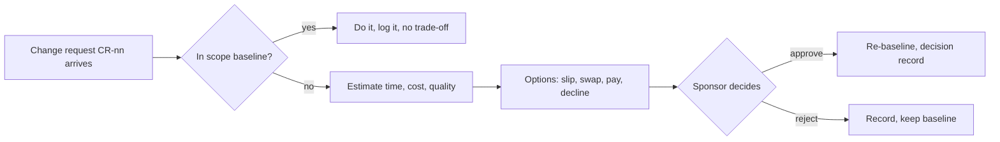

# Change requests · Realtime Quiz · trade-off analysis
Capacity 40 h/week · contingency 56 h · paid capacity 12 USD/h · each request is priced as hours on top of the 504 h baseline

## CR-01 · Add chat (F14, 40 h) to the Must scope · requested by sponsor
| Option | Time impact | Cost impact | Quality impact | Fixed side? |
|--------|-------------|-------------|----------------|-------------|
| A slip the pilot | +1 week (40/40) | 0 USD | FR-N3 chat delivered, but the pilot moves past week 14 and the semester-end grade | violates C-01 |
| B swap: defer F16 question bank (30 h, Could) + F12 notifications (12 h, Should) = 42 h | +0 weeks | 0 USD | Chat (FR-N3) delivered; instructors announce events aloud (F12) and re-enter questions by hand (F16); Must share rises to 340 h / 504 h = 67.5 % | ok |
| C pay: TA 40 h | +0 weeks | 40 x 12 = 480 USD | all scope kept, but 480 USD is 2.4 times the 200 USD budget and overspend has no approver (risk R-03) | violates C-03 |
| D decline: chat stays Could, release 1.1 | +0 weeks | 0 USD | Must stays 300 h / 504 h = 59.5 %; the sponsor's request is not met in the pilot | ok |

Risk to the fixed date (option B): Must grows to 67.5 %, above the 60 % guideline. Mitigation: 56 h contingency stays intact and F14 goes back to Could first if any Must estimate slips.

**Recommendation:** B. It gives the sponsor chat inside the fixed date and the fixed cash. A is rejected because it breaks the pilot date (C-01). C is rejected because it breaks the cash budget (C-03). D is rejected because it leaves the sponsor request unmet when a swap can fund it.

## CR-02 · Anonymous joining (F15, 12 h) · requested by students
| Option | Time impact | Cost impact | Quality impact | Fixed side? |
|--------|-------------|-------------|----------------|-------------|
| A slip the pilot | +0.3 week (12/40) | 0 USD | Guest role delivered; pilot moves past week 14 | violates C-01 |
| B swap: defer F12 notifications (12 h, Should) | +0 weeks | 0 USD | Guest role adds a second login path next to F06 (FR-A1..A4); instructors announce events aloud | ok |
| C pay: TA 12 h | +0 weeks | 12 x 12 = 144 USD | Guest role delivered, but 144 USD exceeds the 85 USD tools-and-reserve line (risk R-03) | violates C-03 |
| D decline for the pilot: release 1.1 | +0 weeks | 0 USD | 50 pilot students log in with F06 accounts; a nickname is cosmetic (Task 2: Could); no new guest path next to F06 authentication | ok |

**Recommendation:** D. Task 2 rated F15 Could, and it adds a second path around F06 authentication for no pilot benefit. A is rejected because it breaks C-01. B is rejected because it drops a Should feature for a cosmetic one. C is rejected because it breaks C-03.

## CR-03 · Semester shortened by 2 weeks: pilot in week 12 · dean
Capacity lost: 2 weeks x 40 h = 80 h; contingency lost: 56 -> 48 h (10 % of 480 h)
New capacity: 12 weeks x 40 h = 480 h. Planned work is 504 h, so 24 h are over capacity before any risk.

| Option | Time impact | Cost impact | Quality impact | Fixed side? |
|--------|-------------|-------------|----------------|-------------|
| A drop all Could (F13 24 + F14 40 + F15 12 + F16 30 = 106 h); F17 (12 h) stays Won't | +0 weeks | 0 USD | Work 504 - 106 - 12 = 386 h, buffer 480 - 386 = 94 h (larger than 48 h). All Must and Should kept, no chat, no media, no question bank | ok |
| B keep all scope, pay TA 104 h (80 h lost + 24 h over capacity) | +0 weeks | 104 x 12 = 1248 USD | all scope kept, but 1248 USD is 6.2 times the 200 USD budget and overspend has no approver (risk R-03) | violates C-03 |
| C keep scope, pilot stays in week 14 | +2 weeks | 0 USD | ignores the dean's new date | violates the dean's new date (new C-01) |

Risk to the fixed date: Must is 300 h / 480 h = 62.5 % of the new capacity, above the 60 % guideline. Mitigation: the 94 h buffer in option A covers it, and no Should feature starts before Must is done.

**Recommendation:** A. It restores a 94 h buffer and touches no Must feature. B is rejected because 1248 USD breaks the cash budget (C-03). C is rejected because it ignores the dean new date.

## Process

