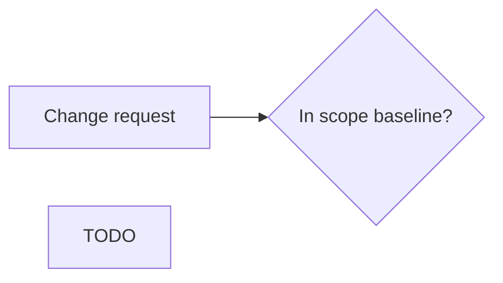

# Change requests · Realtime Quiz · trade-off analysis
Capacity 40 h/week · contingency 56 h · paid capacity 12 USD/h

## CR-01 · Add chat (F14, 40 h) to the Must scope · requested by sponsor
| Option | Time impact | Cost impact | Quality impact | Fixed side? |
|--------|-------------|-------------|----------------|-------------|
| A slip the pilot | +1 week (40/40) | 0 USD | TODO | violates C-01 |
| B swap: defer TODO (TODO h) | +0 weeks | 0 USD | TODO | ok |
| C pay: TA 40 h | +0 weeks | 40 x 12 = 480 USD | TODO | violates C-03 |

**Recommendation:** TODO (one option, one sentence per rejected option)

## CR-02 · Anonymous joining (F15, 12 h) · requested by students
| Option | Time impact | Cost impact | Quality impact | Fixed side? |
|--------|-------------|-------------|----------------|-------------|
| TODO   |             |             |                |             |

**Recommendation:** TODO

## CR-03 · Semester shortened by 2 weeks: pilot in week 12 · dean
Capacity lost: 2 weeks x 40 h = TODO h; contingency lost: TODO h

| Option | Time impact | Cost impact | Quality impact | Fixed side? |
|--------|-------------|-------------|----------------|-------------|
| TODO   |             |             |                |             |

**Recommendation:** TODO

## Process

