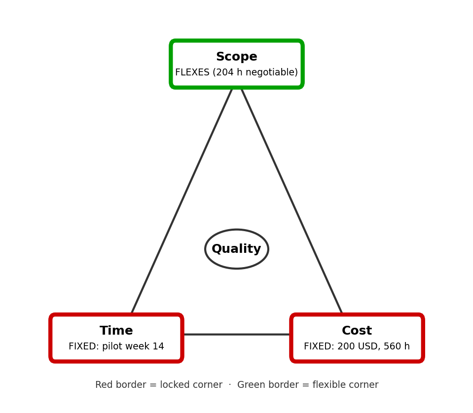

# Constraint analysis · Realtime Quiz · v1.0

Sources: the Lab-02 Setup recap table (the authoritative input, because `lab01/charter.md` is not in this repository) and `features.csv`.

| Constraint | Fixed or flexes | Evidence (quote, source) | If violated |
|------------|-----------------|--------------------------|-------------|
| Time | **FIXED (driver)** | "14-week semester; go-live is a pilot with 50 students in week 14" (recap table, Duration; charter, Milestones). The semester calendar cannot move; grades are due at semester end. | No pilot = no capstone grade. |
| Cost | **FIXED** | "Linode VPS at gicitc.com 25 USD/month × 4 = 100, domain 15, tools and reserve 85" = 200 USD (recap table, Cash budget; charter, Budget). | Overspend has no approver: every dollar over 200 USD is paid by the team. |
| Scope | **FLEXES** | features.csv: 8 Must (300 h), 5 Should (110 h), 4 Could (94 h). Should + Could = 204 h of 504 h (40.5 %) are negotiable. | Should and Could items move to Won't; Must items are never cut. |
| Quality | **FIXED (floor)** | "Non-functional requirements (broadcast under 500 ms, WCAG AA, CI green) and the Definition of Done" (recap table, Quality). | The pilot with 50 students shows lag, accessibility failures or an unreleasable build. |
| Resources | **FIXED** | "4 students × 10 h/week = 40 h/week"; "40 h × 14 weeks = 560 person-hours" (recap table, Team and Effort capacity). | Extra capacity can only be bought at 12 USD/h; 40 h cost 480 USD, which breaks the cash budget. |
| Risk | **FLEXES (within the buffer)** | "504 h planned work + 56 h (10 %) contingency" (recap table, Effort capacity; charter, Budget). | Once the 56 h are used, every further surprise must come out of Should and Could scope. |

## Project shape
Realtime Quiz is a fixed-date, fixed-budget project, and the driver is the week-14 pilot with 50 students that cannot move. The second fixed side is cost: 200 USD in cash and 560 person-hours, with no approver for overspend. Scope absorbs surprises through the Should and Could classes (204 h, 40.5 % of the 504 h planned), and the 56 h contingency is the first buffer before any feature is cut.

## Quality floor (never traded)
1. Real-time broadcast latency stays under 500 ms (non-functional requirement).
2. All student and instructor screens meet WCAG AA (non-functional requirement).
3. The CI pipeline is green on the main branch before every merge and before the week-14 pilot (Definition of Done).

## Iron triangle
Red border = locked corner, green border = flexible corner, quality sits in the centre.

