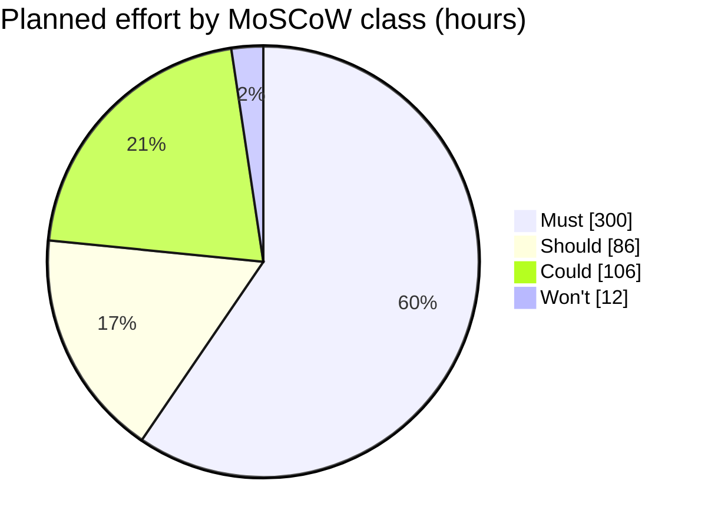

# MoSCoW rating for the week-14 pilot · Realtime Quiz

Test order: Must = pilot cancelled or unlawful without it; Should = painful but a workaround exists for one pilot; Could = nice to have, first to drop; Won't = explicitly not in this pilot.

| Id | Feature | Plan | Mine | h | Justification |
|----|---------|------|------|---|---------------|
| F01 | Create quizzes with multiple-choice questions | Must | Must | 44 | Must: without quizzes there is nothing to run at the pilot; no workaround. |
| F02 | Students participate in real time | Must | Must | 52 | Must: students answering live is the purpose of the pilot; without it the pilot is cancelled. |
| F03 | Instant feedback and scoring | Must | Must | 28 | Must: marking 50 live answers by hand is not workable; no workaround. |
| F04 | Leaderboards | Must | Must | 24 | Must: live ranking is part of the agreed Must scope (FR-S8); ranking 50 students by hand during a session is not workable. |
| F05 | Real-time updates over WebSocket | Must | Must | 48 | Must: the broadcast-under-500-ms quality floor cannot be met without it, so the pilot would not be real-time. |
| F06 | Authentication and roles | Must | Must | 44 | Must: 50 student accounts and the instructor role need login; without it results are visible to everyone (unlawful for student data). |
| F07 | Timer per question | Must | Must | 28 | Must: agreed Must scope (FR-Q3); fairness between 50 simultaneous students needs one shared clock. |
| F08 | Multiple concurrent sessions | Must | Must | 32 | Must: agreed Must scope (FR-S2); without it two instructors cannot run sessions at the same time and the pilot needs one sequential slot. |
| F09 | Responsive design | Should | Should | 20 | Should: students can use a laptop browser for one pilot; phone layout is painful but a workaround exists. |
| F10 | Analytics and reporting | Should | Should | 30 | Should: instructors can read per-session scores from the leaderboard and a SQL query for the pilot. |
| F11 | Export results to CSV and PDF | Should | Should | 24 | Should: instructors can open the CSV in a spreadsheet; PDF is cosmetic for a pilot. Workaround exists. |
| F12 | Real-time notifications | Should | Should | 12 | Should: the instructor can announce events aloud in the room; workaround exists. |
| F13 | Multimedia in questions | Should | **Could** | 24 | Could: pilot quizzes are text-only (to be agreed with two instructors); images can follow in release 1.1. |
| F14 | Chat during sessions | Could | Could | 40 | Could: nice to have; sessions run without it and it is the first to drop. |
| F15 | Anonymous joining with nickname | Could | Could | 12 | Could: pilot students log in with accounts from F06; a nickname is cosmetic. |
| F16 | Question bank shared between quizzes | Could | Could | 30 | Could: instructors can re-enter or duplicate questions for one pilot; first to drop. |
| F17 | Admin role and user management | Could | **Won't** | 12 | Won't: the PM manages the 50 pilot accounts by SQL script; no admin screen is needed for one pilot. |

## Rating changes against features.csv
- **F13 Should → Could:** the pilot quizzes are text-only, so no pilot session needs media (24 h freed from Should).
- **F17 Could → Won't:** a SQL script covers account management for 50 users, so the admin screen is explicitly out of this pilot (12 h).

## Totals
| Class | Features | Hours | Share of 504 h |
|-------|----------|-------|----------------|
| Must | 8 | 300 | 59.5 % |
| Should | 4 | 86 | 17.1 % |
| Could | 4 | 106 | 21.0 % |
| Won't | 1 | 12 | 2.4 % |
| **Total** | **17** | **504** | **100.0 %** |

Must share = 300 h / 504 h × 100 = 59.5 % (guideline: 60 % or less).

The margin is thin: 60 % of 504 h is 302.4 h, so only 2.4 h of Must growth fits under the guideline. Any Must estimate increase must be paid for by moving a feature down or by writing a "Risk to the fixed date" paragraph. Should + Could + Won't still add up to 204 h, the same negotiable pool as in `constraints.md`.

