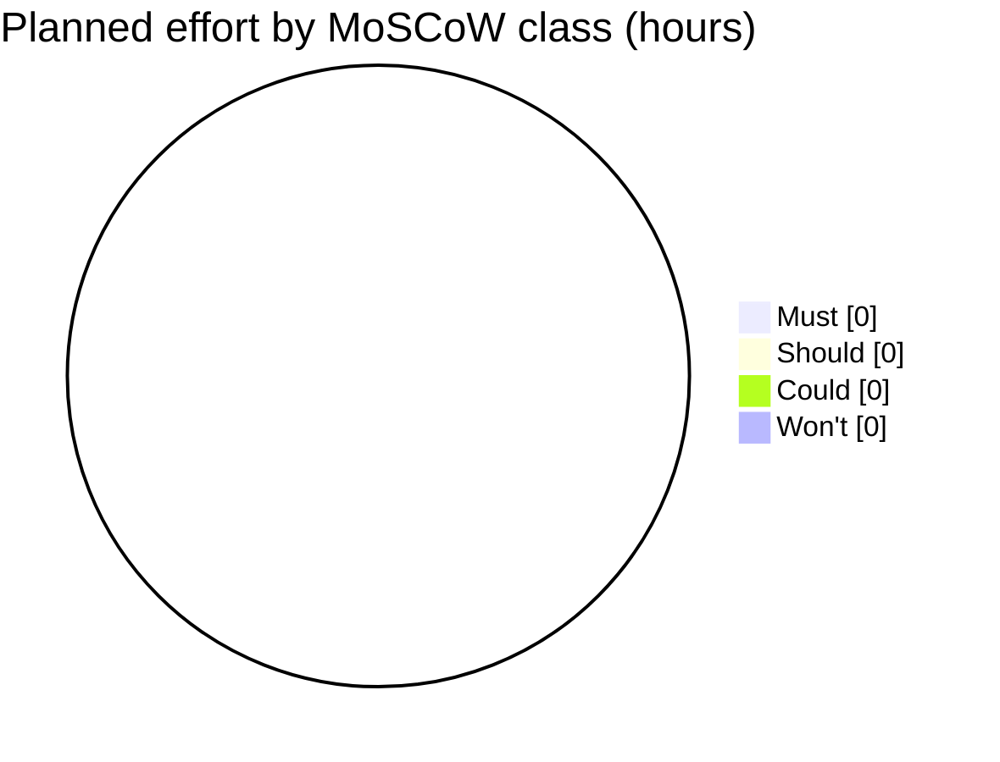

# MoSCoW rating for the week-14 pilot · Realtime Quiz

Test order: Must = pilot cancelled without it; Should = painful but a
workaround exists; Could = nice to have; Won't = not in this pilot.

| Id  | Feature                          | Plan   | Mine | h  | Justification |
|-----|----------------------------------|--------|------|----|---------------|
| F01 | Create quizzes with MCQ          | Must   | TODO | 44 | TODO |
| F02 | Students participate in real time| Must   | TODO | 52 | TODO |
| F03 | Instant feedback and scoring     | Must   | TODO | 28 | TODO |
| F04 | Leaderboards                     | Must   | TODO | 24 | TODO |
| F05 | Real-time updates over WebSocket | Must   | TODO | 48 | TODO |
| F06 | Authentication and roles         | Must   | TODO | 44 | TODO |
| F07 | Timer per question               | Must   | TODO | 28 | TODO |
| F08 | Multiple concurrent sessions     | Must   | TODO | 32 | TODO |
| F09 | Responsive design                | Should | TODO | 20 | TODO |
| F10 | Analytics and reporting          | Should | TODO | 30 | TODO |
| F11 | Export results to CSV and PDF    | Should | TODO | 24 | TODO |
| F12 | Real-time notifications          | Should | TODO | 12 | TODO |
| F13 | Multimedia in questions          | Should | TODO | 24 | TODO |
| F14 | Chat during sessions             | Could  | TODO | 40 | TODO |
| F15 | Anonymous joining with nickname  | Could  | TODO | 12 | TODO |
| F16 | Question bank shared             | Could  | TODO | 30 | TODO |
| F17 | Admin role and user management   | Could  | TODO | 12 | TODO |

## Totals
| Class  | Features | Hours | Share of 504 h |
|--------|----------|-------|----------------|
| Must   | TODO     | TODO  | TODO %         |
| Should | TODO     | TODO  | TODO %         |
| Could  | TODO     | TODO  | TODO %         |
| Won't  | TODO     | TODO  | TODO %         |

Must share = TODO h / 504 h x 100 = TODO %  (guideline: 60 % or less)

